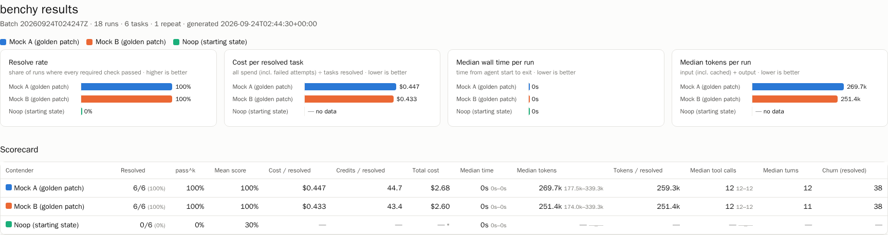
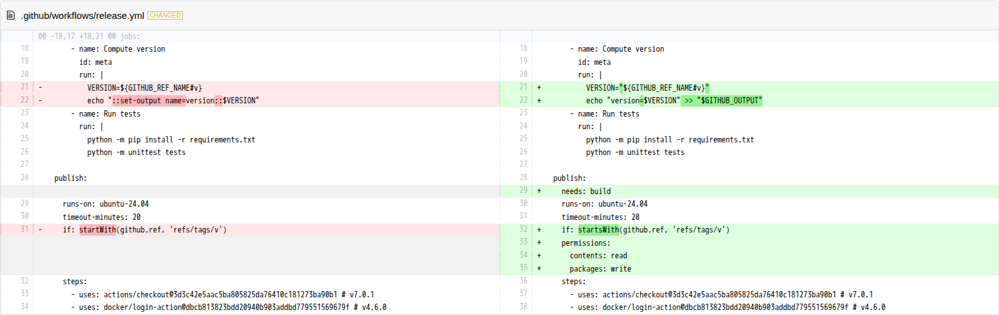

# benchy

A small, fair, fully unattended benchmark for AI coding agents on everyday **business DevOps
work**: GitHub Actions, Artifactory, Rancher/Kubernetes, Docker/Podman.

Start it, walk away, and come back to:

- **A git branch per run** holding exactly what the agent changed, built on a pinned commit of
  a real repository.
- **Screenshots** of every changed file (side-by-side diff with lines added and deleted), plus a
  summary card for each run.
- **Metrics**: pass/fail from hidden checks, wall and API time, tokens (input, cached, output,
  reasoning), tool calls, turns, and **GitHub AI Credits / $**.
- **A report** (HTML, Markdown, CSV) comparing contenders such as *GPT-5.6 Luna · xhigh* vs
  *Sonnet 5 · high*.

Everything runs in containers, the agent included, so every contender gets the same OS, tools,
limits, and starting point. Your machine needs only Docker (Docker Desktop with WSL on Windows)
and bash. No Python, Node, or CLI installs, and **no GitHub PAT**.



## Quick start (Windows + WSL + Docker Desktop)

In a WSL terminal, with Docker Desktop's WSL integration enabled:

```bash
git clone <this repo> ~/benchy && cd ~/benchy   # clone inside WSL, not under /mnt/c
./bench doctor                                  # checks Docker, paths, images, logins
./bench build                                   # builds the two pinned images (~5 min, once)
./bench selftest                                # free end-to-end check with mock agents (~4 min)

./bench login copilot                           # one-time browser sign-in (device code)
cp contenders.example.yaml contenders.yaml      # pick your models/efforts
./bench run --repeats 3                         # the starter suite, 6 tasks x contenders x 3
```

Then open `out/report/latest.html`. On Windows, from WSL:
`explorer.exe "$(wslpath -w out/report/latest.html)"`.

### How sign-in works without a PAT

`./bench login copilot` runs `copilot login --device-code` **inside** the agent image. It prints
a short code; you open `github.com/login/device` in your normal browser and approve with your
usual SSO/2FA. The resulting OAuth token (the same kind the Copilot CLI on your laptop uses) is
stored in a Docker volume called `benchy-auth`. It never touches this repository or `out/`.
`./bench logout` deletes it; revoke it under GitHub → Settings → Applications. GitHub Enterprise
Cloud with data residency: set `COPILOT_GH_HOST` (see `copilot help environment`). Your org's
Copilot policy must allow Copilot CLI.

`./bench login claude` does the same for Claude Code, if you also want to compare against it.

Corporate proxy? `HTTP(S)_PROXY`/`NO_PROXY` are passed through. Custom CA:
`export BENCHY_CA_BUNDLE=/path/to/ca.pem`.

## What happens in a run

```
./bench run
  plan      contenders x tasks x repeats, interleaved (A1 B1 A2 B2 ...), rotating who goes first
  for each run:
    setup     [grader, network]   clone repo@pinned SHA -> apply task setup -> 1-commit workspace
    agent     [agent, sandboxed]  copilot -p ... / claude -p ... with a hard timeout
    finalize  [grader, no network] commit result -> branch -> hidden checks -> screenshots -> metrics
  report      [grader, no network] HTML + Markdown + CSV + PNG summary
```

Outputs (all under `out/`, git-ignored):

| Path | What |
|---|---|
| `out/repos/<repo>.git` | bare repo; one branch `bench/<run-id>` per run: *upstream → task setup → agent result* |
| `out/runs/<run-id>/screenshots/` | `00-summary.png` + one PNG per changed file |
| `out/runs/<run-id>/diff.html`, `diff.patch`, `numstat.tsv` | full diff, interactive and raw |
| `out/runs/<run-id>/metrics.json`, `grade.json` | normalized metrics; every check with its output |
| `out/runs/<run-id>/raw/` | redacted harness output: transcript, usage JSON, telemetry, logs |
| `out/report/<batch>/` | `index.html`, `summary.md`, `results.csv`, `summary.png`, `aggregate.json` |

Every changed file gets a side-by-side screenshot (this one is the `gha-ci-fix` golden solution):



Look at an agent's work like any other branch:
`git clone out/repos/microblog.git /tmp/mb && git -C /tmp/mb log --oneline --all`.

## The starter suite

All tasks start from [microblog](https://github.com/miguelgrinberg/microblog) (MIT, a real Flask
app with a Dockerfile and tests) pinned at `a975ef6`. Each task is a short ticket a platform team
would plausibly receive.

| Task | Scenario | Checked by (hidden) |
|---|---|---|
| `bugfix-unit` | Incident: revoked API tokens keep working | hidden model and API tests, new regression test, full suite |
| `gha-ci-add` | Add CI to a repo that has none | actionlint, triggers, read-only token, tests run, **SHA-pinned actions that really exist**, cache, concurrency, timeouts |
| `gha-ci-fix` | Tag-release workflow broken (deprecated `set-output`, bad expression, missing `needs`, 403 on push) | actionlint, output wiring, `needs`, least-privilege `packages: write` |
| `container-harden` | Production Dockerfile + Compose for Docker Desktop **and** Podman | hadolint, multi-stage, pinned base, numeric non-root user, healthcheck, `.dockerignore`, Compose spec, no literal secrets |
| `artifactory-route` | Route base images + pip + pushes through Artifactory (`artifactory.example.com`) | registry prefixes, BuildKit secret (no creds in layers/args), CI login via secrets, push to docker-local, gitleaks |
| `rancher-deploy` | Helm chart + Rancher Fleet bundle for staging/production | helm lint, kubeconform `-strict` (offline schemas), resources, probes, hardened securityContext, secretKeyRef, Fleet targets |

Every task also gets three built-in checks: **regression** (the repo's original tests still
pass), **scope** (only files the ticket concerns were touched), and **secrets** (gitleaks finds
nothing new).

## Reading the results: what we measure and why

The goal is a comparison that is simple enough to share and hard to game.

**Did it work?**
- **Resolve rate**: share of runs where *every required* hidden check passed. This is the
  headline number.
- **pass^k**: share of tasks solved in *every* repeat. Consistency matters more than a lucky
  run when a team relies on the tool daily.
- **Mean score**: weighted share of checks passed. Shows partial credit and near misses.
- **Failure modes**: timeout, harness error, broke existing tests, out of scope, secret
  introduced, checks failed.

**What did it cost?**
- **Cost per resolved task** = all spend (failed attempts included) ÷ runs resolved. This is the
  fairest single cost number: a cheap model that fails half the time is not cheap.
- **AI Credits**, as reported by Copilot CLI (GitHub bills Copilot in AI Credits, 1 credit =
  $0.01, since June 2026). Reasoning effort has no separate multiplier; higher effort costs more
  only through extra output/reasoning tokens, which you can see.
- **Tokens**: fresh input, cached input, cache writes, output, and reasoning. Cached tokens are
  much cheaper, so the breakdown explains cost differences.

**How did it work?**
- **Wall time** (measured by benchy around the process) and **API time** (reported by the
  harness).
- **Tool calls** by kind (read / edit / shell / search / web) and **turns**. Many more calls for
  the same result usually means flailing.
- **Churn on resolved runs** (+/− lines). Smaller correct diffs are easier to review.

Medians are shown with min–max. A dash (—) means *not reported*, never zero.

### Where the numbers come from

Copilot CLI's `/usage` command is interactive-only, so benchy collects the same data from
Copilot's machine-readable outputs and records which one each value came from
(`metrics.json → sources`):

1. `--usage-output-file` JSON (AI credits as nano-AIU, API time, per-model tokens)
2. session events (`$COPILOT_HOME/session-state/*/events.jsonl`)
3. `--output-format json` event stream
4. OpenTelemetry file export (`COPILOT_OTEL_FILE_EXPORTER_PATH`): token counts per model call,
   one span per tool call
5. the exit summary text

If two sources disagree on tokens by more than 5%, the run gets a warning. Claude Code's numbers
come from its `stream-json` result message; its cost is Claude Code's own client-side estimate.

### Fairness rules the runner enforces

Every contender gets: the same prompt text (a shared preamble plus the ticket), the same image
digests and CLI versions, the same repository commit, the same CPU/memory limits and timeout,
the same tool permissions, no custom instructions (`--no-custom-instructions`) and no MCP
servers. Order is interleaved and rotated per repeat to spread API load and time-of-day effects.
There are no retries. Timeouts count as failures, but their spend still counts. The model
*reported* by the harness is recorded next to the one requested.

### What not to conclude

- Six tasks on one repository is a **smoke test for your context**, not a general ranking of
  models. Add tasks from your own backlog (below) before making purchasing decisions.
- Run at least 3 repeats (5 is better). With fewer, differences inside the min–max ranges are
  noise.
- Models, CLIs, and prices change monthly. Every report records versions and dates; compare
  batches only when those match.

## Configuring contenders

`contenders.yaml` (copy from `contenders.example.yaml`):

```yaml
contenders:
  - {name: "GPT-5.6 Luna · xhigh", harness: copilot, model: gpt-5.6-luna, effort: xhigh}
  - {name: "Sonnet 5 · high",      harness: copilot, model: claude-sonnet-5, effort: high}
```

Useful `./bench run` options: `--tasks gha-ci-add,rancher-deploy`, `--repeats 5`,
`--timeout-scale 1.5`, `--keep-workspaces` (keep each run's working tree for inspection),
`--no-screenshots`. Environment: `BENCHY_AGENT_CPUS` (default 4), `BENCHY_AGENT_MEMORY` (6g),
`BENCHY_ENGINE=podman` (experimental).

If a model is missing from `pricing.yaml` and its harness reports no cost, its $ column stays
empty. Add the model's per-1M-token rates there.

## Adding your own tasks

```
tasks/<id>/
  task.yaml          # title, repo, timeout, setup steps, allowed_paths, checks
  prompt.md          # the ticket the agent sees (after tasks/_preamble.md)
  setup/*.patch      # turns the pinned repo into the task's starting state
  hidden/            # grader-only: solution.patch (golden) + any check scripts
repos/<id>.yaml      # target repo: https URL + full 40-char commit SHA, deps, test command
suites/<name>.yaml   # which tasks a suite runs
```

Checks are shell commands run from the finished workspace. Exit 0 means pass. They can use `$LIB/checklib.py`
(workflow, Dockerfile, Compose, Kubernetes, and Fleet assertions), `$HIDDEN`, `$BASELINE`,
`$VENV`, and `$SCHEMAS`. Then run `./bench selftest`. It proves that every task **fails** in its
starting state and **passes** with its golden solution, so a broken or pre-solved task can't slip
into a published comparison. Use `repos/` to point tasks at your own internal repositories,
but keep those tasks and results private.

## Adding another harness

Implement `src/benchy/harness/<name>.py` (`command`, `prepare`, `harvest`, `parse`; see
`base.py`), register it in `harness/__init__.py`, and add the CLI to `docker/agent.Dockerfile`.
Everything downstream (grading, screenshots, report) is harness-independent.

## Development

```bash
./bench test        # unit tests (parsers, redaction, config validation, checks reject wrong answers)
./bench selftest    # sandbox probe + every task: starting state fails, golden solution passes
./bench shell grader
```

Versions of everything in the images are pinned, with checksums, in `docker/versions.env`.
See [SECURITY.md](SECURITY.md) for the sandbox and credential model, and
[THIRD_PARTY_NOTICES.md](THIRD_PARTY_NOTICES.md) for licenses.

Current limitations: amd64 images only (Apple Silicon runs them under emulation); container
builds are validated statically (no nested Docker/Podman daemon); VS Code agent mode can't be
driven headlessly, so Copilot is benchmarked through Copilot CLI with the same models.
